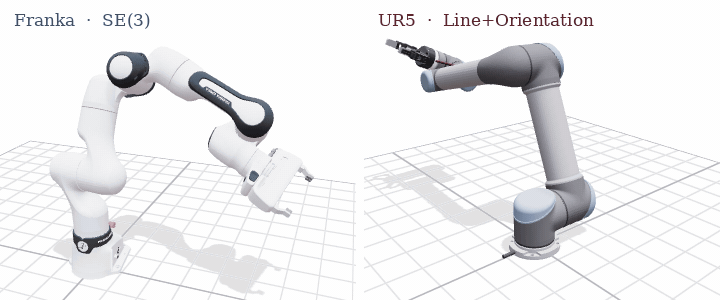
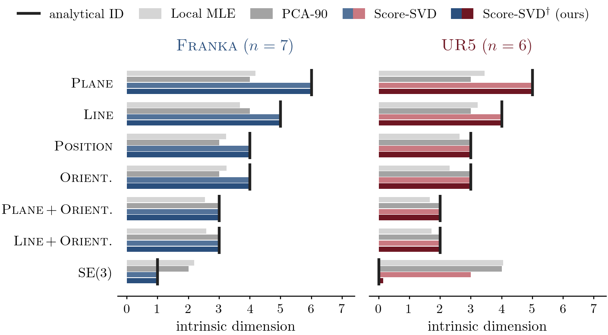
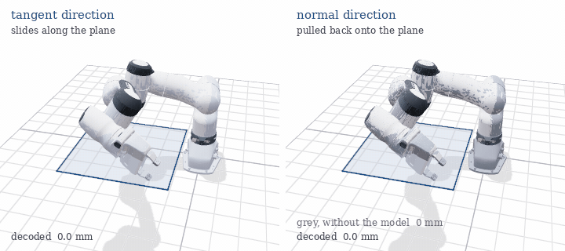
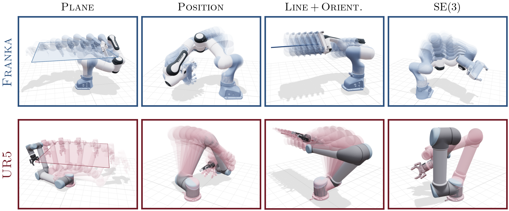

<div align="center">

# Exploring the Intrinsic Geometry of Diffusion Models<br>with Constrained Inverse Kinematics

[Miguel Angel Rogel Garcia](https://starslab.ca/people/miguel-rogel/)<sup>\*</sup> &nbsp;·&nbsp;
[Phone Thiha Kyaw](https://www.phonethk.com)<sup>\*</sup> &nbsp;·&nbsp;
[Jonathan Kelly](https://starslab.ca/people/prof-jonathan-kelly/)

STARS Laboratory, University of Toronto Institute for Aerospace Studies &nbsp;·&nbsp; <sup>\*</sup>equal contribution

**Conference on Robot Learning (CoRL) 2026**<br>
<sub>An earlier version appeared at the RSS 2026 Workshop on Diffusion for Robot Learning</sub>

[](https://arxiv.org/abs/2606.26408)
[](https://arxiv.org/abs/2606.26408)
[](https://papers.starslab.ca/diffusion-ik-geometry/)
[](https://huggingface.co/mlsdpk/ConstraintIK)



</div>

Constrained inverse kinematics gives diffusion models a data manifold whose geometry is known in closed form.
Each task-space constraint defines a configuration-space manifold of known intrinsic dimension, from discrete IK branches to self-motion manifolds.
For the 6-DoF UR5 and the 7-DoF Franka, we train one conditional diffusion model across seven constraint families and compare the geometry it learns against this ground truth.

<table>
<tr>
<td width="50%" valign="top">

**The score recovers the intrinsic dimension.**
Score-SVD reads the dimension of the constraint manifold from the learned score, and our variant Score-SVD<sup>†</sup> extends it to the zero-dimensional UR5 SE(3) case. The estimate matches the analytical value on all 14 constraint and robot pairs.



</td>
<td width="50%" valign="top">

**Tangent directions move the arm along the manifold.**
For the Franka under a plane constraint, stepping along a tangent singular direction of the score matrix slides the arm with its gripper on the plane. Along a normal direction the same step taken without the model (grey) moves the gripper hundreds of millimetres off the plane, while the model pulls the decoded arm back onto it.



</td>
</tr>
</table>

**Straight latent paths stay close to the constraint manifold.**
Linear interpolation between DDIM-inverted IK solutions decodes into motions that follow the constraint, with median errors between 0.4 and 2.4 mm, and that switch cleanly between disconnected IK branches of the UR5 under a full pose constraint.

<p align="center"></p>

## Installation

```bash
git clone https://github.com/utiasSTARS/ConstraintIK.git && cd ConstraintIK
python3.10 -m venv .venv && source .venv/bin/activate
pip install -e ".[viz,test,pinned]"   # versions used for the paper; drop "pinned" for the latest releases
python scripts/download.py            # paper models and evaluation targets from the Hugging Face Hub
```

IKFast solvers for both robots come from `ikfast_pybind`, which pip compiles from source (this needs CMake and a C++ compiler) and which builds only on Python 3.10. Everything was tested on Ubuntu 20.04 with Python 3.10, PyTorch 2.4.1 and CUDA 12.1. The `pinned` extra installs this PyTorch build, which runs with NVIDIA drivers from version 525. Without it, pip installs the latest PyTorch, which may need a newer driver; in that case install the PyTorch build that matches your CUDA version first (see pytorch.org).

## Explore

```bash
python scripts/viser_explorer.py --device cuda      # open the printed URL in a browser
```

Pick a robot and a constraint, then walk the straight latent path between two IK solutions, the latent plane through three of them, or the singular directions of the score matrix, and watch the decoded arm and its constraint error update live.

## Reproduce the paper

Every table and figure is rebuilt from the small result files in `results/` on a CPU.

```bash
bash reproduce.sh tables figures      # tables/*.tex and figures/*.pdf
```

To recompute `results/` from the models (about 5 GPU hours on one RTX 8000), run `bash reproduce.sh eval`, or pick a single step. On our hardware the evaluation scripts reproduce the committed results exactly; other GPUs may change the last digits.

| Result | Command |
|---|---|
| Intrinsic dimension of every constraint (Fig. 2, App. D) | `python scripts/eval_id.py --robot {ur5,franka}` |
| Estimate against noise level and perturbation count (Fig. 3, App. D) | `python scripts/eval_id_sweep.py --robot {ur5,franka} --sweep {t,k,t_model_anchored}` |
| Spectral gap off the constraint manifold (App. D) | `python scripts/eval_perturbation.py --robot {ur5,franka}` |
| Latent interpolation error and noise level (Figs. 3 and 4, App. E) | `python scripts/eval_interpolation.py --robot {ur5,franka}` |
| Sensitivity and tangent overlap (Table 2) | `python scripts/eval_flatness.py --robot {ur5,franka}` |
| Training-set size (App. C) | `python scripts/size_sweep.py eval --model joint`, and with `download.py --size_sweep` the N = 40k models via `--model per_family --sizes 40000 --out results/size_sweep/per_family_40k.json` |

The training data and both models can also be rebuilt from scratch. Data generation reproduces the released training sets bit for bit, and training runs 500k steps per robot (about 8 hours on one RTX 8000).

```bash
bash reproduce.sh data train          # writes checkpoints/retrained/
```

## Repository

```
src/constraint_ik/   robots and IKFast, constraints, sine-cosine encoding, model, DDIM, data generation,
                     intrinsic-dimension estimators, interpolation targets, interpolation, flatness, plotting, viser helpers
scripts/             one script per experiment, plus make_tables.py, make_figures.py and the viser tools
configs/tbar.json    selected noise level per robot, constraint and interpolation method
results/             committed outputs behind every table and figure
tests/               unit tests (pytest)
```

## Citation

```bibtex
@inproceedings{rogelgarcia2026intrinsic,
  title     = {Exploring the Intrinsic Geometry of Diffusion Models with Constrained Inverse Kinematics},
  author    = {Rogel Garcia, Miguel Angel and Kyaw, Phone Thiha and Kelly, Jonathan},
  booktitle = {Conference on Robot Learning (CoRL)},
  year      = {2026},
  url       = {https://arxiv.org/abs/2606.26408}
}
```

Released under the [MIT license](LICENSE). Robot models are redistributed under their own licenses (see `assets/robots/README.md`).
